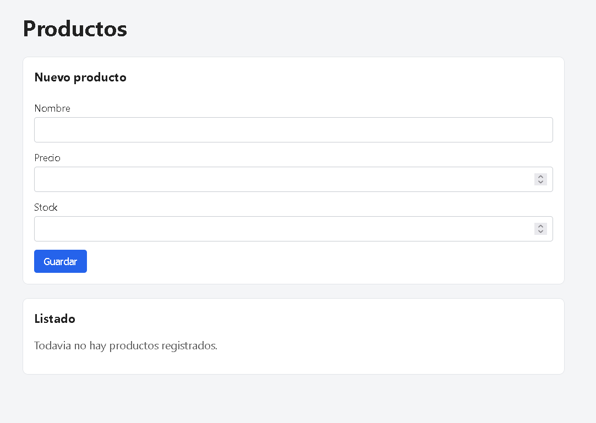
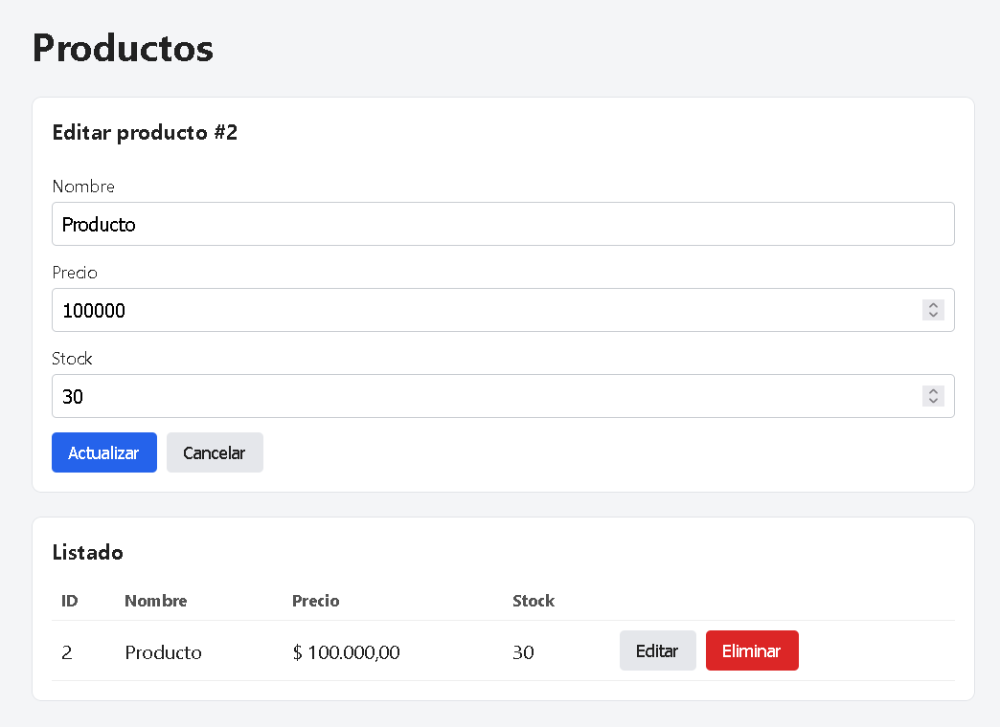
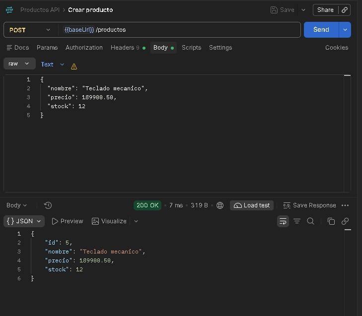
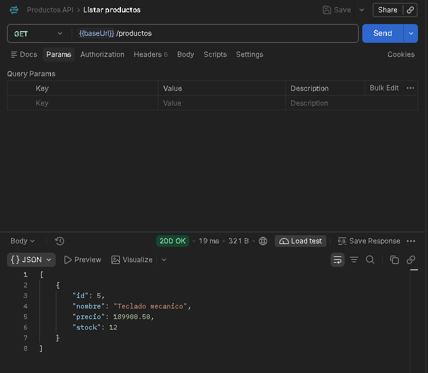
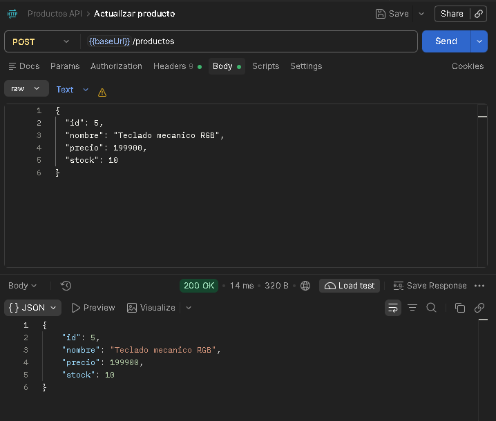
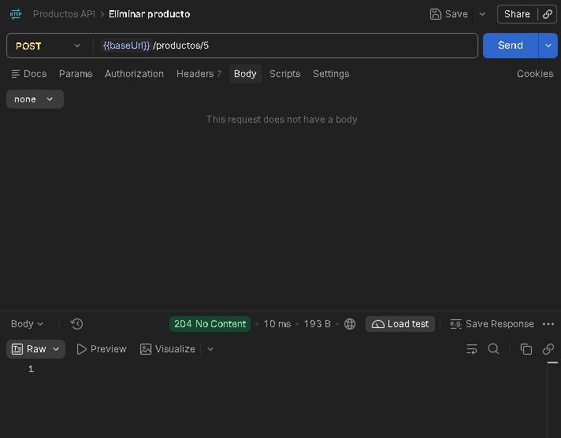

# product-service

Sistema para registrar, listar, editar y eliminar productos (nombre, precio y stock).

- **backend/**: API REST con Spring Boot 3.5 y Java 21. Guarda los datos en H2 (archivo local) usando JPA.
- **frontend/**: React con Vite. Consume la API con `fetch`.

## Capturas

Pantalla inicial:



Editando un producto desde la tabla:



Peticiones en Postman (crear, listar, actualizar y eliminar):









## Cómo correrlo

### Con Docker

```bash
docker compose up --build
```

Frontend en http://localhost:3000 y API en http://localhost:8080/productos.

### Sin Docker

Java 21, Maven y Node 18 o superior.

Backend:

```bash
cd backend
mvn spring-boot:run
```

Frontend http://localhost:5173:

```bash
cd frontend
npm install
npm run dev
```

Por defecto el frontend llama a http://localhost:8080. Si el backend corre en otra URL, crea un `.env` en `frontend/` con `VITE_API_URL`.


## Endpoints

| Método | Ruta | Qué hace |
|--------|------|----------|
| GET | `/productos` | Lista todos los productos |
| POST | `/productos` | Crea el producto, o lo actualiza si el JSON trae `id` |
| POST | `/productos/{id}` | Elimina el producto |

Ejemplo de body:

```json
{ "nombre": "Teclado", "precio": 120000.50, "stock": 5 }
```

Esteban Aguilera Contreras
